<p align="center">
  <picture>
    <source media="(prefers-color-scheme: dark)" srcset="assets/rackhand-header-dark.svg">
    
  </picture>
</p>

<p align="center">
  <a href="https://github.com/Matrixx0070/rackhand/actions/workflows/test.yml"></a>
  <a href="LICENSE"></a>
  <a href="https://modelcontextprotocol.io"></a>
</p>

# Rackhand — SSH MCP server for AI agents

Rackhand is a self-hosted, remote [MCP](https://modelcontextprotocol.io) server. It gives Claude, ChatGPT, Cursor or any
AI agent a real shell, real files and background jobs on **your own VPS**, and on every machine that VPS can reach over
SSH. Machines it cannot reach, behind NAT or a firewall, open a [tunnel](#machines-the-connector-cannot-reach-tunnels) to it instead.

```
AI client (Claude, ChatGPT, Kimi, Cursor, your own agent)
        │  HTTPS, one secret URL
        ▼
Rackhand on your VPS ──SSH/SFTP──▶ any host in hosts.json
```

> **Read this first.** The connector URL contains a secret, and that secret is the only authentication.
> **Whoever has the URL has a root shell on the machine**, and on every host listed in `hosts.json`.
> Treat it like a root password: do not paste it into chats, issues, screenshots or logs.
> On AWS EC2, anyone with the URL can also use the instance's IAM role - check what that role allows
> before you install (see [Security](#security)).

18 tools, one install command, no account, no database. Version 1.9.0.

Formerly **ssh-mcp**. The service, paths and settings keep that name, so existing installs upgrade in place.

## Quick start

On a fresh Linux VPS (x86-64 or arm64, systemd, public IP, ports **80** and **443** open), as root:

```bash
curl -fsSL https://raw.githubusercontent.com/Matrixx0070/rackhand/main/install.sh | sudo bash
```

The installer:

1. installs Node.js 22 if Node 20+ is missing,
2. puts the server in `/opt/ssh-mcp`,
3. writes a random secret to `/etc/ssh-mcp.env`,
4. starts the systemd service `ssh-mcp` (it listens on `127.0.0.1` only),
5. puts [Caddy](https://caddyserver.com) in front of it with an automatic HTTPS certificate for
   `https://<your-ip-with-dashes>.sslip.io` (no domain needed),
6. checks that the server answers and prints your connector URL:

```
https://203-0-113-10.sslip.io/mcp/<64 hex characters>
```

Options (environment variables in front of `bash`): `DOMAIN=mcp.example.com` to use your own domain,
`NO_CADDY=1` if you already run a reverse proxy, `PUBLIC_IP=...` to skip the IP lookup. The top of
[`install.sh`](install.sh) lists all of them. If something already listens on port 443, the installer leaves it
alone and tells you which proxy rule to add.

Ports 80 and 443: if this machine's own firewall (ufw or firewalld) is on, the installer opens them in it
(`NO_FIREWALL=1` to skip). A firewall at your provider, such as an AWS security group or a cloud panel firewall,
is outside the machine: open 80 and 443 there yourself. If they are closed, the installer says so.

### Ports 80 and 443 already in use

The installer never changes a program that already holds one of these ports.

- **Only port 80 is taken** (a web server, a panel): Caddy gets its certificate over port 443 alone and never
  listens on 80. Nothing to do.
- **Port 443 is taken** (nginx, Apache, Traefik, a hosting panel): the installer does not install Caddy. It prints
  this nginx `server` block with your address filled in:

```nginx
server {
    listen 443 ssl;
    server_name 203-0-113-10.sslip.io;
    ssl_certificate     /etc/letsencrypt/live/203-0-113-10.sslip.io/fullchain.pem;    # certbot certonly --nginx -d 203-0-113-10.sslip.io
    ssl_certificate_key /etc/letsencrypt/live/203-0-113-10.sslip.io/privkey.pem;
    location / {
        proxy_pass http://127.0.0.1:8787;
        proxy_http_version 1.1;
        proxy_set_header Host $host;
        proxy_set_header X-Forwarded-For $proxy_add_x_forwarded_for;
        proxy_set_header X-Forwarded-Proto https;
        proxy_set_header Upgrade $http_upgrade;          # reverse tunnels
        proxy_set_header Connection $http_connection;
        proxy_buffering off;                             # replies stream
        proxy_request_buffering off;
        client_max_body_size 0;                          # file uploads
        proxy_read_timeout 1h;
        proxy_send_timeout 1h;
    }
}
```

  For any other proxy, send `https://<your-address>` to `http://127.0.0.1:8787` and make sure it speaks HTTP/1.1
  to the connector and passes `Upgrade` and `Connection` (reverse tunnels), does not buffer replies or uploads and
  has no upload size limit, allows requests of an hour, and sends `Host`, `X-Forwarded-For` and
  `X-Forwarded-Proto: https`.

Run the same command again to **upgrade**: `hosts.json` and the secret are kept, the old `server.ts` is backed up,
and it is put back automatically if the new one does not answer.

## Connect your AI client

The server speaks standard MCP over Streamable HTTP, so any client that supports remote MCP servers works.
Menus move around; the names below are the ones in use when this was written.

| Client | How |
|---|---|
| **Claude** (web, desktop, mobile) | Settings → Connectors → *Add custom connector* → paste the URL |
| **Claude Code** | `claude mcp add --transport http vps <URL>` |
| **ChatGPT** | Settings → Apps & Connectors → Advanced → turn on *Developer mode*, add a connector with the URL, authentication: *No authentication*. Which plans may use write-capable custom connectors is decided by OpenAI and has changed over time. |
| **Kimi Code CLI** | `kimi mcp add --transport http vps <URL>` |
| **Cursor, VS Code, Gemini CLI, others** | a remote/HTTP MCP server entry, e.g. `{"mcpServers": {"vps": {"url": "<URL>"}}}` |
| **Your own agent** | any MCP SDK: Streamable HTTP client pointed at the URL |

Then ask the assistant something like *"run `uname -a` on my VPS"*.

## Tools

Every tool takes `host`: a name from `list_hosts`. `local` is the VPS the server runs on; every other host is
reached over SSH and behaves the same way.

### Fewer round trips

Every tool call from a model costs seconds (round trip + thinking); the work on the host takes milliseconds.
So the fastest way to work is to put more into one call.

| Tool | Input | What it does |
|---|---|---|
| `batch` | `ops[]` (max 30), `stop_on_error` (true), `cwd`, `session` | Runs several steps in ONE call, in order. Each op is exactly one of `{bash}`, `{read}`, `{write}`, `{edit}` with the arguments of that tool (without `host`). Stops at the first failure (non-zero exit, timeout, failed edit, missing file) and skips the rest, unless `stop_on_error` is false. A `cd` in one bash op carries to the later bash ops of the batch. The ops share the ~100 KB output budget; whatever is cut stays in a file on the host. |

```json
{"host": "local", "cwd": "/app", "ops": [
  {"write": {"file_path": "/app/a.ts", "content": "..."}},
  {"edit":  {"file_path": "/app/b.ts", "old_string": "x", "new_string": "y"}},
  {"bash":  {"command": "npm test", "quiet": true}},
  {"read":  {"file_path": "/app/out.log", "limit": 50}}
]}
```

```
=== [1/4] write /app/a.ts | ok | 0.00s ===
Wrote 12 bytes to local:/app/a.ts
=== [2/4] edit /app/b.ts | ok | 0.00s ===
...
=== [3/4] bash npm test | FAILED | 4.20s ===
...
[exit code: 1]
=== [4/4] read /app/out.log | skipped ===
=== batch: 2 ok, 1 failed, 1 skipped | 4.21s ===
```

The server also sends short **instructions** at `initialize` (the `INSTRUCTIONS` constant in `server.ts`) that point
any model at `batch`, the `files` / `edits` arrays, `ssh_exec_many`, `quiet` and background jobs.

### Shell and files

Same parameter names as the Bash / Read / Write / Edit tools many coding agents already know.

| Tool | Input | What it does |
|---|---|---|
| `bash` | `command`, `timeout` (ms, 120000, max 1800000), `cwd`, `session`, `run_in_background`, `quiet`, `confirm` | Runs a command. stdout+stderr merged in order; a failure adds `[exit code: N]`, a timeout `[timed out after Ns - exit code: 124]`. Starts in the home directory unless `cwd` is given. Calls sharing a `session` name share a working directory that `cd` changes. Output over ~100 KB is cut in the middle and kept in full in a file on the host. `quiet` returns only the end of the output (last ~2 KB, ~8 KB after a failure). `run_in_background` returns a `jobId` (follow with `ssh_job`). |
| `read` | `file_path`, `offset`, `limit` (2000) - or `files[]` (max 20) | Text as numbered lines (`cat -n` style); lines over 2000 chars are cut. Images (png, jpg, gif, webp, up to 4 MB) come back as images. One bad file does not fail the rest. |
| `write` | `file_path` + `content` - or `files[]` of `{file_path, content, mode}` (max 50) | Creates or overwrites files, in parallel, over one connection. Parent directories are created. |
| `edit` | `file_path`, `old_string`, `new_string`, `replace_all` - or `edits[]` (max 50) | Exact text replacement; `old_string` must be unique unless `replace_all`. Edits to one file apply in order and the file is written only if all of them succeed. |

### Commands, jobs, code

| Tool | Input | What it does |
|---|---|---|
| `ssh_exec` | `command`, `timeout_sec` (120, max 1800), `confirm` | Runs a command; returns `exit`, stdout and stderr separately. |
| `ssh_exec_many` | `commands[]` of `{id, command, timeout_sec}` (max 10), `confirm` | Runs them concurrently; one block per id with exit code, stdout, stderr, duration. |
| `ssh_spawn` | `command`, `confirm` | Starts the command in the background and returns a `jobId` at once. |
| `ssh_job` | `jobId`, `action`: `status` \| `tail` \| `wait` \| `kill` | Job state, end of the log, block until exit, or stop it. |
| `ssh_jobs` | `limit` (50) | Lists jobs newest first: `running`, `exited` (with code) or `lost`. |
| `exec_code` | `language`: `python` \| `node` \| `bash`, `code`, `timeout_sec`, `confirm` | Writes the code to a temp file, runs it, returns exit, stdout, stderr. |
| `list_hosts` | - | Lists the hosts in `hosts.json`. |
| `add_host` | `name`, `host`, `username`, `port` (22), `fingerprint`, `replace` | Connects another server: tests the login, pins its host key, saves it ([More hosts](#more-hosts)). |
| `sftp_read` / `sftp_write` / `sftp_list` | `path`, ... | Plain file read (utf8/base64), write and directory listing. |
| `bridge` | `ttl_hours` (12, max 168) | Returns a time-limited URL and a one-line installer for the `box` command (below). |
| `audit` | `limit` (50), `contains`, `since_minutes` | Shows the audit log (below): what was run on the hosts, from any chat or client. |

Which one to use: `batch` for anything with more than one step; `bash` / `read` / `write` / `edit` for single steps;
`ssh_exec_many` for several independent commands; `run_in_background` + `ssh_job` for anything long; the bridge for
big, binary or many files.

### The tripwire

A model can make the kind of mistake that has no undo. So a short list of commands is refused unless the call says
`confirm: true` (`box exec -y` on the bridge):

| Refused without `confirm` | Examples |
|---|---|
| Recursive delete of `/`, the home directory or a top-level system directory | `rm -rf /`, `rm -rf / tmp/x` (the stray space), `rm -rf ~`, `rm -rf /etc`, `rm -rf /usr/*`, `find / -delete` |
| Recursive `chmod` / `chown` of `/` or a system directory | `chmod -R 777 /`, `chown -R app /etc` |
| Formatting or overwriting a disk | `mkfs.ext4 /dev/sdb1`, `wipefs -a /dev/sda`, `dd of=/dev/sda`, `> /dev/nvme0n1` |
| Powering off or restarting the machine | `shutdown`, `reboot`, `poweroff`, `halt`, `init 0`, `systemctl reboot` |
| A fork bomb | `:(){ :\|:& };:` |

```
Error: Refused by the tripwire: recursive delete of "/etc". Nothing was run. This is on the short list of commands
that are rarely meant and hard to undo; if the user really wants it, send it again with confirm: true.
```

Everything else runs without a question: `rm -rf /opt/app/releases/old`, `rm -rf /var/lib/apt/lists/*`,
`find /var/log -name '*.gz' -delete`, `mkfs.ext4 disk.img`, `dd if=/dev/sda of=backup.img` and `echo "rm -rf /"` are
none of its business. It looks inside `sudo`, `bash -c '...'`, `ssh host '...'`, `$(...)` and scripts fed to a shell as
a here-document, on every host and through every tool that runs a command.

**It is a seat belt, not a lock.** It reads the command text and never runs anything to find out, so it is easy to get
around on purpose (`echo reboot | bash`, a script file, a variable that expands to `/`). It does not make the
connector safe to hand to someone you do not trust, and it is not a substitute for backups. Refusals and confirmed
commands are in the [audit log](#audit-log) (`tripwire` / `confirmed`). `TRIPWIRE=off` in `/etc/ssh-mcp.env` turns it off.

## More hosts

Ask the assistant: *"add my server 203.0.113.10 as web-1, user deploy"*. That is the `add_host` tool:

1. The first call creates the connector's own SSH key (once, in `/var/lib/ssh-mcp/keys`), tries to log in, and when
   the server does not know the key yet, answers with the one line to add to `~/.ssh/authorized_keys` on that
   server, and with the fingerprint of the host key the server presented.
2. You add the line on the server (that is the only manual step) and check the fingerprint there:
   `ssh-keygen -lf /etc/ssh/ssh_host_ed25519_key.pub`.
3. The second call logs in, runs a test command, **pins the host key** and saves the host. It works at once as
   `host: "web-1"` in every tool.

```
Added host "web-1": deploy@203.0.113.10:22
Host key pinned: SHA256:... (ssh-ed25519)
Key exchange: mlkem768x25519-sha256 (post-quantum) - the connection is made by this machine's OpenSSH client, everything else runs inside it
Test: logged in as deploy on web-1
```

A pinned host is only ever talked to if it presents that same key. `add_host` has no password option on purpose:
a password would have to pass through the model and the chat. It never overwrites an existing name unless told
`replace: true`, and keeps the previous file as `hosts.json.bak`.

By hand it is the same thing: `/opt/ssh-mcp/hosts.json` (see [`hosts.example.json`](hosts.example.json)) lists what the
server may reach. It is read on every call, so no restart is needed.

```bash
ssh-keygen -t ed25519 -N '' -f /root/.ssh/id_ed25519               # a key (once)
ssh-copy-id -i /root/.ssh/id_ed25519.pub deploy@203.0.113.10        # per target host
ssh-keyscan -t ed25519 203.0.113.10 2>/dev/null | ssh-keygen -lf -  # -> SHA256:... for hostFingerprint
```

```json
{
  "local": { "local": true },
  "web-1": { "host": "203.0.113.10", "username": "deploy", "privateKeyPath": "/root/.ssh/id_ed25519",
             "hostFingerprint": "SHA256:..." }
}
```

Use keys. If a key has a passphrase, put it in an environment variable in `/etc/ssh-mcp.env` and name that variable
in `passphraseEnv`; never put a secret in `hosts.json` itself.

### Post-quantum key exchange

Traffic that is recorded today can be decrypted later by whoever gets a large enough quantum computer, unless the
key exchange that protected it was a post-quantum one. For the hosts it reaches over SSH, Rackhand uses one wherever
the server has it:

- `add_host` first tries a connection made by this machine's **OpenSSH client**, restricted to the post-quantum key
  exchanges (`mlkem768x25519-sha256` from OpenSSH 9.9, `sntrup761x25519-sha512` from 9.0) and to the pinned host
  key. That connection only carries bytes to the server's own SSH port; the connector's commands, files and jobs
  run inside it. So no login and no data crosses the network under a classical key exchange, not even the first
  login. (The one thing that does is the first look at the server's host key, which is public.)
- The result says which it is, and the host is saved with `"pq": true`. `list_hosts` shows
  `(post-quantum key exchange)`, and the audit log marks each such call with `(pq)` and records the algorithm (`kex`).
- **No silent downgrade.** A host added this way never falls back to a classical connection by itself. If the
  server later stops offering post-quantum key exchange, or forwarding is switched off, calls fail and say why,
  until you decide: `"pq": false` for that host in `hosts.json`, or `add_host` again with `replace: true`.
- When post-quantum is not possible, `add_host` says why and adds the host as a classical one (`"pq": false`):
  the server's SSH is older than OpenSSH 9.0, it does not allow TCP forwarding for that login
  (`AllowTcpForwarding`, or `no-port-forwarding` on the key), or this machine has no OpenSSH client that can do it.
- For a host you wrote into `hosts.json` yourself, add `"pq": true`. It needs `hostFingerprint` and a
  `privateKeyPath` without a passphrase. Hosts without the setting are connected to as before.
- Behind a port mapping (a container, a router), or when the server's SSH listens on one address only, `add_host`
  asks the server where its own SSH is and saves that as `pqVia`.
- `PQ_SSH=require` in `/etc/ssh-mcp.env` refuses every remote host that is not post-quantum, and `add_host` then
  adds nothing else. `PQ_SSH=off` turns the feature off.

What it costs: making the connection takes two SSH handshakes instead of one (about 0.3 s with OpenSSH 9.6 on one
machine). It is then **kept and shared**: an unused connection stays open for 60 seconds, and up to four calls run
on one at the same time, so the calls that follow need no handshake at all. Measured that way, a call to a
post-quantum host took 48 ms, against 80 ms for a classical host, which connects anew every time. `PQ_SSH_KEEP` in
`/etc/ssh-mcp.env` sets the seconds; `0` makes a connection per call. A connection that died while it was not
used is replaced without the call failing, and a server that allows only one session per connection
(`MaxSessions 1`) gets a connection per overlapping call.

What it does not cover:

- **The other leg.** Between your AI client and this server the protection is TLS. Caddy offers a post-quantum key
  exchange there (X25519MLKEM768) and uses it when the client asks for it; whether the client asks is the
  client's choice, and this server cannot force it.
- **Someone in the path while a host is added** can make a server look as if it had no post-quantum key exchange.
  The host is then added as a classical one, and the result says so; `PQ_SSH=require` refuses instead.
- Only the key exchange is post-quantum. Host keys and login keys are the usual ones: breaking those lets an
  attacker impersonate a server in the future, not read what was recorded in the past.

### Machines the connector cannot reach: tunnels

A machine behind NAT or a firewall - a PC at home, a laptop, a server in a private network - can be a host too. It
is not connected to; it connects. Ask the assistant: *"add my home PC as home-pc, user frank, it is behind NAT"*, which
is `add_host` with `tunnel: true` (and no `host`). The answer is one command to run on that machine, as root:

```bash
curl -fsSL https://<your-connector>/t/<link> | sudo bash
```

The link works once, within 30 minutes (`curl -fsSL <link>` shows the script without running it). The script

1. checks for an OpenSSH client with a post-quantum key exchange (OpenSSH 9.0 or newer), OpenSSL 1.1.1 or newer,
   curl, and an SSH server on the port given to `add_host` (22 unless told otherwise),
2. adds the connector's key to that user's `~/.ssh/authorized_keys`,
3. makes a key for the tunnel in `/etc/ssh-mcp-tunnel`, and sends the connector that key and the machine's SSH host keys,
4. installs the systemd service `ssh-mcp-tunnel`, which keeps an SSH connection open to the connector **over HTTPS**
   (port 443) and opens it again when it drops,
5. waits until the connector has logged in through it, and prints `connected: ...`.

From then on the machine is `127.0.0.1:<port>` on the connector, with its host key pinned, and every tool works
with it. `list_hosts` tells whether its tunnel is open:

```
home-pc: frank@127.0.0.1:20200 (reverse tunnel: open, post-quantum key exchange mlkem768x25519-sha256)
```

and a call while it is not open says so, instead of a bare "connection refused".

How it is locked down:

- **Nothing new has to be reachable, on either side.** The tunnel comes in through the connector's HTTPS port (Caddy
  passes the HTTP upgrade on to the connector), and the machine only makes outgoing connections.
- **At the connector, a tunnel can do one thing.** Each tunnel gets an `sshd -i` of its own, with a configuration
  (`/var/lib/ssh-mcp-tunnel/sshd_config`) that allows a remote forward to the one port that tunnel's key is bound to
  (`permitlisten`) and nothing else: no shell and no command (`MaxSessions 0`), no forwarding into the connector's
  machine (`AllowTcpForwarding remote`, `PermitOpen none`), **post-quantum key exchange only**. It logs in as the
  account `sshmcp-tunnel`, which is created on first use, without a password or a shell.
- **Both ends are pinned.** The connector's tunnel host key is written into the script (fetched over HTTPS) and
  pinned on the machine; the machine's SSH host key must be one of those it reported, and is pinned on the connector.
- The tunnel's address on the connector is a secret of its own. An unknown address, a used-up link, another key,
  another port: nothing.
- A machine that comes back on a new connection (after a reboot, or when its network changed) replaces the one it
  left open at once, instead of waiting until that one times out.
- `add_host` with `replace: true` hands the name to another machine; the old one keeps working until the new one is
  in, then its key and address stop working.

To undo it on the machine: `systemctl disable --now ssh-mcp-tunnel; rm -r /etc/ssh-mcp-tunnel
/etc/systemd/system/ssh-mcp-tunnel.service`, and remove the connector's line from `authorized_keys`. On the
connector, remove the host from `hosts.json`: its key goes from the tunnel's `authorized_keys` at the next start or
`add_host`. Without root or systemd, `SSHMCP_TUNNEL_FOREGROUND=1` keeps the tunnel in the foreground instead of a
service (`SSHMCP_TUNNEL_DIR` and `SSHMCP_AUTHORIZED_KEYS` say where its files and the connector's key go).

Settings, in `/etc/ssh-mcp.env`: `TUNNEL=off` turns tunnels off; `TUNNEL_PORTS` (`20200-20999`) are the ports they
get; `TUNNEL_USER` is the account they log in as; `TUNNEL_DIR` is where their `sshd` keeps its files.

## The bridge and the `box` command

For an assistant that has its own sandbox shell: `bridge` returns `https://<host>/b/<token>`, and from that shell

```bash
curl -fsS '<url>/cli' -o /tmp/box && bash /tmp/box install

box exec [-t SEC] [-C DIR] [-y] [HOST] -- 'command'   # merged output of any size, same exit code; "-" reads a script from stdin
box put  ./file [HOST:]/remote/path [MODE]       # one file, any size, binary-safe, all-or-nothing
box get  [HOST:]/remote/path [./file|-]
box push ./dir [HOST:]/remote/dir [-x PATTERN]   # whole tree as one tar.gz stream
box pull [HOST:]/remote/dir ./dir [-x PATTERN]
box call TOOL '{json}'                           # any of the 18 tools
box tools
```

Each command is one HTTPS request that does not pass through the model, so a script can do dozens of operations
in one tool call and run several at once with `&` or `xargs -P`. For scale, on one small cloud VM: 50 MB up in
about 8 s, a 4,300-file tree in under 4 s, one command in about 0.6 s.

- An upload is renamed over its target only when every byte arrived; an existing file keeps its mode and owner.
- A dropped connection stops the transfer on the host.
- The token is `<expiry>.<HMAC of expiry with MCP_SECRET>`: no state, valid until it expires, and it cannot mint
  another one. **It grants the same access as the connector URL.** The only way to revoke one early is a new secret.

## Audit log

Every tool call and every bridge request is written to `/var/lib/ssh-mcp/audit/audit.jsonl`, readable only by the
user the service runs as. Ask the assistant *"show me the audit log"* (the `audit` tool), or read the file:

```
$ tail -f /var/lib/ssh-mcp/audit/audit.jsonl | jq -c .
{"t":"2026-11-18T15:30:01.120Z","id":"9f2c41aa","via":"mcp","ip":"203.0.113.5","ua":"Claude-User","tool":"bash","host":"local","what":"npm test","cwd":"/app"}
{"t":"2026-11-18T15:30:05.320Z","id":"9f2c41aa","ok":false,"exit":1,"ms":4200}
```

- **Two lines per call.** The first is written *before* the call runs, so a command that takes the server down with
  it is still on record; the second carries the result (`ok`, `exit`, `err`, `ms`). They share an `id`.
- **Who:** `ip` is the address your reverse proxy saw, `ua` the client's user agent, `via` is `mcp` (the connector
  URL) or `bridge`; `tok` ties a bridge request to the `bridge` call that created its URL.
- **What:** for commands the command itself; for file tools the paths and sizes. **File contents are never logged.**
  Each step of a `batch` has its own entry (`batch: "<id>#2/4"`). A call that reached its host over a
  [post-quantum key exchange](#post-quantum-key-exchange) has `kex` in its result line.
- **Masking:** values that look like credentials (`password=...`, `--token ...`, `Authorization: Bearer ...`, private
  keys, the connector's own secret and bridge tokens) are replaced with `***` before anything is written, and long
  commands are cut to 2000 characters. This is best effort: do not rely on it to keep secrets out of the log.
- **Server events:** every start of the server is logged, and if the file is removed, emptied or replaced, the next
  entry says so (`"event":"reset"`).
- **Rotation:** at 20 MB the file moves to `audit.jsonl.1` (up to `.5`), so the log is bounded at about 120 MB.

Settings (in `/etc/ssh-mcp.env`, then restart): `AUDIT_MAX_MB` (20), `AUDIT_KEEP` (5), `AUDIT_DIR`, and
`AUDIT_LOG=off` to turn it off.

What it is not: requests with a wrong secret are not logged (use your proxy's access log for that), and the log
lives on the machine it describes - whoever has the connector URL can also delete it. If it has to survive that,
ship it elsewhere (any log forwarder can follow the file).

## Operating it

| | |
|---|---|
| Logs | `journalctl -u ssh-mcp -f` |
| Restart | `systemctl restart ssh-mcp` (cuts calls in flight for about 2 seconds) |
| New secret | `rm /etc/ssh-mcp.env`, run the installer again, re-add the connector with the new URL |
| Upgrade | run the installer again |
| Uninstall | `systemctl disable --now ssh-mcp && rm -rf /opt/ssh-mcp /etc/ssh-mcp.env /etc/systemd/system/ssh-mcp.service /var/lib/ssh-mcp`, then remove the `# ssh-mcp` block from `/etc/caddy/Caddyfile` |

The service runs with `KillMode=process` and `OOMPolicy=continue`: restarting, crashing or an out-of-memory kill of
the connector does not take down the programs that were started through it.

State on the host: `/var/lib/ssh-mcp/jobs` (background job logs, not pruned), `/var/lib/ssh-mcp/sessions` (one
remembered working directory per `bash` session), `/var/lib/ssh-mcp/out` (full copies of oversized output, deleted
after 3 days), `/var/lib/ssh-mcp/audit` (the audit log), `/var/lib/ssh-mcp/keys` (the SSH key `add_host` uses).

For a careful upgrade of a busy server there is [`upgrade/deploy.sh`](upgrade/deploy.sh): it swaps in
`/opt/ssh-mcp/server.new.ts`, checks the tool list, the audit log, the tripwire, a real `batch` call and the bridge, and rolls
back by itself.
[`upgrade/rehearse.sh`](upgrade/rehearse.sh) rehearses that on a throwaway copy of the service first.

## Security

- **The URL is the key.** There is no login, no per-user permission and no allow-list of commands. Anything that
  can call the URL can run anything as the user the service runs as, which is **root** by default.
- The server binds to `127.0.0.1`; the reverse proxy is the only public entry, and only over HTTPS.
- Every host in `hosts.json` is fully reachable by anything that can call the connector. Keep the list short and
  prefer a non-root `username` on the targets.
- Connections to those hosts use [post-quantum key exchange](#post-quantum-key-exchange) where the server has it,
  and a host added that way does not fall back. The leg from the AI client to this server is TLS, and how strong
  that is against a future quantum computer depends on the client.
- [Tunnels](#machines-the-connector-cannot-reach-tunnels) come in through the HTTPS port and can only pass the
  connector's connections on to the machine's own SSH server; their key exchange is post-quantum only.
- **Cloud credentials on the machine are in reach too.** On AWS EC2 the instance's IAM role can be used by anyone
  with a shell, so anyone with the URL has that role's permissions. The installer prints a warning when it finds a
  role. Give the instance no role, or one with only the permissions the machine itself needs.
- An AI model decides which commands to run. Review what it does, keep backups, and do not point it at a machine
  whose loss you cannot afford. The [tripwire](#the-tripwire) catches a few well-known accidents; it is not a
  permission system.
- Optional hardening: restrict the proxy to your AI provider's published outbound IP ranges, use your own domain,
  rotate the secret, run the service as a less privileged user.

Found a security problem? Please report it privately (GitHub: Security → Report a vulnerability) rather than in a public issue.

## Development

```bash
npm ci
npm run typecheck
npm test          # 174 black-box tests over the HTTP endpoint, against "local", an in-process SSH server and a real sshd
```

The whole server is one file, [`server.ts`](server.ts), run with `tsx`; [`box.sh`](box.sh) is the bridge client the
server hands out. Configuration is by environment variable: `MCP_SECRET` (required, 32+ characters), `PORT` (8787),
`HOSTS_FILE` (`./hosts.json`), `JOBS_DIR` (`/var/lib/ssh-mcp/jobs`), `PUBLIC_URL` (only if the proxy does not send
`X-Forwarded-Host`), the `AUDIT_*` settings above, `TRIPWIRE=off`, `PQ_SSH` (`off` or `require`), `PQ_SSH_KEEP`, and
`TUNNEL`, `TUNNEL_PORTS`, `TUNNEL_USER` and `TUNNEL_DIR`.

The fifteen post-quantum tests and the eight tunnel tests start a private `sshd` on a loopback port and read its
log, so they need the OpenSSH server and a client with a post-quantum key exchange (`apt-get install openssh-server
openssh-client`), and the tunnel tests openssl and curl as well; without them they are skipped and say so.

## License

[MIT](LICENSE)
